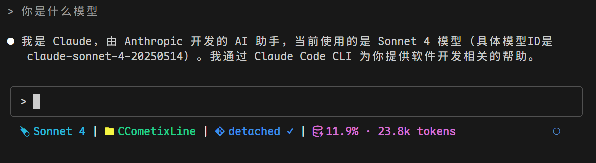

# CCometixLine

[English](README.md) | [中文](README.zh.md)

A high-performance Claude Code statusline tool written in Rust with Git integration, usage tracking, interactive TUI configuration, and Claude Code enhancement utilities.


## Screenshots



The statusline shows: Model | Directory | Git Branch Status | Context Window Information

## Features

### Core Functionality
- **Advanced Git integration** with branch, status, tracking, SHA display, and remote status
- **Smart model display** with custom name mapping and multiple display formats
- **Enhanced usage tracking** with progress bars, warning thresholds, and flexible token units  
- **Flexible directory display** with path truncation, case styling, and parent directory options
- **Comprehensive session tracking** with multiple time formats and idle time monitoring
- **Detailed cost tracking** with multiple currency formats and precision control
- **Minimal design** using Nerd Font icons with customizable separators

### Interactive TUI Features
- **Interactive main menu** when executed without input
- **Advanced TUI configuration interface** with real-time preview and intelligent controls
- **Rich theme system** with multiple built-in presets and custom theme support
- **Granular segment customization** with extensive configuration options for each segment
- **Smart configuration management** with validation, defaults, and reset functions

### Extended Configuration Options
- **Usage Segment**: Progress bar controls, warning thresholds, token unit selection, bar percentage/token display
- **Model Segment**: Display formats (name/full/custom), version info, abbreviation, custom name mapping
- **Session Segment**: Time formats (auto/short/long/digital), milliseconds, compact mode, idle time tracking  
- **Cost Segment**: Currency formats (auto/fixed/compact/scientific), precision control, cost breakdown, warning thresholds
- **Git Segment**: SHA display control, remote status, stash count, tag display, status formats, branch length limits
- **Directory Segment**: Path length limits, case styling, full path toggle, parent directory display, home abbreviation

### Claude Code Enhancement
- **Context warning disabler** - Remove annoying "Context low" messages
- **Verbose mode enabler** - Enhanced output detail
- **Robust patcher** - Survives Claude Code version updates
- **Automatic backups** - Safe modification with easy recovery

## Installation

### Quick Install (Recommended)

Install via npm (works on all platforms):

```bash
# Install globally
npm install -g @cometix/ccline

# Or using yarn
yarn global add @cometix/ccline

# Or using pnpm
pnpm add -g @cometix/ccline
```

Use npm mirror for faster download:
```bash
npm install -g @cometix/ccline --registry https://registry.npmmirror.com
```

After installation:
- ✅ Global command `ccline` is available everywhere
- ⚙️ Follow the configuration steps below to integrate with Claude Code
- 🎨 Run `ccline -c` to open configuration panel for theme selection

### Claude Code Configuration

Add to your Claude Code `settings.json`:

**Linux/macOS:**
```json
{
  "statusLine": {
    "type": "command", 
    "command": "~/.claude/ccline/ccline",
    "padding": 0
  }
}
```

**Windows:**
```json
{
  "statusLine": {
    "type": "command", 
    "command": "%USERPROFILE%\\.claude\\ccline\\ccline.exe",
    "padding": 0
  }
}
```

**Fallback (npm installation):**
```json
{
  "statusLine": {
    "type": "command", 
    "command": "ccline",
    "padding": 0
  }
}
```
*Use this if npm global installation is available in PATH*

### Update

```bash
npm update -g @cometix/ccline
```

<details>
<summary>Manual Installation (Click to expand)</summary>

Alternatively, download from [Releases](https://github.com/Haleclipse/CCometixLine/releases):

#### Linux

#### Option 1: Dynamic Binary (Recommended)
```bash
mkdir -p ~/.claude/ccline
wget https://github.com/Haleclipse/CCometixLine/releases/latest/download/ccline-linux-x64.tar.gz
tar -xzf ccline-linux-x64.tar.gz
cp ccline ~/.claude/ccline/
chmod +x ~/.claude/ccline/ccline
```
*Requires: Ubuntu 22.04+, CentOS 9+, Debian 11+, RHEL 9+ (glibc 2.35+)*

#### Option 2: Static Binary (Universal Compatibility)
```bash
mkdir -p ~/.claude/ccline
wget https://github.com/Haleclipse/CCometixLine/releases/latest/download/ccline-linux-x64-static.tar.gz
tar -xzf ccline-linux-x64-static.tar.gz
cp ccline ~/.claude/ccline/
chmod +x ~/.claude/ccline/ccline
```
*Works on any Linux distribution (static, no dependencies)*

#### macOS (Intel)

```bash  
mkdir -p ~/.claude/ccline
wget https://github.com/Haleclipse/CCometixLine/releases/latest/download/ccline-macos-x64.tar.gz
tar -xzf ccline-macos-x64.tar.gz
cp ccline ~/.claude/ccline/
chmod +x ~/.claude/ccline/ccline
```

#### macOS (Apple Silicon)

```bash
mkdir -p ~/.claude/ccline  
wget https://github.com/Haleclipse/CCometixLine/releases/latest/download/ccline-macos-arm64.tar.gz
tar -xzf ccline-macos-arm64.tar.gz
cp ccline ~/.claude/ccline/
chmod +x ~/.claude/ccline/ccline
```

#### Windows

```powershell
# Create directory and download
New-Item -ItemType Directory -Force -Path "$env:USERPROFILE\.claude\ccline"
Invoke-WebRequest -Uri "https://github.com/Haleclipse/CCometixLine/releases/latest/download/ccline-windows-x64.zip" -OutFile "ccline-windows-x64.zip"
Expand-Archive -Path "ccline-windows-x64.zip" -DestinationPath "."
Move-Item "ccline.exe" "$env:USERPROFILE\.claude\ccline\"
```

</details>

### Build from Source

```bash
git clone https://github.com/Haleclipse/CCometixLine.git
cd CCometixLine
cargo build --release

# Linux/macOS
mkdir -p ~/.claude/ccline
cp target/release/ccometixline ~/.claude/ccline/ccline
chmod +x ~/.claude/ccline/ccline

# Windows (PowerShell)
New-Item -ItemType Directory -Force -Path "$env:USERPROFILE\.claude\ccline"
copy target\release\ccometixline.exe "$env:USERPROFILE\.claude\ccline\ccline.exe"
```

## Usage

### Configuration Management

```bash
# Initialize configuration file
ccline --init

# Check configuration validity  
ccline --check

# Print current configuration
ccline --print

# Enter TUI configuration mode
ccline --config
```

### Theme Override

```bash
# Temporarily use specific theme (overrides config file)
ccline --theme cometix
ccline --theme minimal
ccline --theme gruvbox
ccline --theme nord
ccline --theme powerline-dark

# Or use custom theme files from ~/.claude/ccline/themes/
ccline --theme my-custom-theme
```

### Claude Code Enhancement

```bash
# Disable context warnings and enable verbose mode
ccline --patch /path/to/claude-code/cli.js

# Example for common installation
ccline --patch ~/.local/share/fnm/node-versions/v24.4.1/installation/lib/node_modules/@anthropic-ai/claude-code/cli.js
```

## Default Segments

Displays: `Directory | Git Branch Status | Model | Context Window`

### Git Status Indicators

- Branch name with Nerd Font icon
- Status: `✓` Clean, `●` Dirty, `⚠` Conflicts  
- Remote tracking: `↑n` Ahead, `↓n` Behind

### Model Display

Shows simplified Claude model names:
- `claude-3-5-sonnet` → `Sonnet 3.5`
- `claude-4-sonnet` → `Sonnet 4`
- `claude-fable-5-2` → `Fable 5.2`
- `claude-opus-5-5` → `Opus 5.5` (200K context)
- `claude-opus-5-5[1m]` → `Opus 5.5 1M` (1M context)

The built-in catalog lives in the repository-root [`models.toml`](models.toml), including Claude families and GLM, Kimi, and Qwen names, aliases, and context limits. It is embedded in the executable at compile time, so no companion file is needed after installation. To add a model, edit this file, run `cargo test` and `cargo build --release`, then replace the installed executable. No Rust changes are needed. For example:

```toml
[[models]]
pattern = "claude-fable-5-2"
aliases = ["fable-5-2", "claude-5-2-fable"]
match_mode = "model_id"
display_name = "Fable 5.2"
context_limit = 200000
```

`aliases` is optional. `match_mode = "model_id"` matches complete IDs, allowing dates and named suffixes such as `latest` and `preview`, while preventing `Fable 5` from matching `Fable 5.2`. Omitting the mode retains case-insensitive substring matching. The first matching entry wins.

Name resolution uses **user overrides → embedded catalog → automatic Claude parsing → the display name supplied by Claude Code**. Automatic parsing continues to support new versions/families, legacy IDs, and `[1m]`.

For custom names, unusual model IDs, or different context limits, edit `~/.claude/ccline/models.toml` (on Windows: `%USERPROFILE%\.claude\ccline\models.toml`):

```toml
[[models]]
pattern = "claude-fable-5-2"
display_name = "Fable 5.2"
context_limit = 200000
```

If the file contains `models = []`, replace that line with the entries above. User overrides use the same format as the catalog, including optional `aliases` and `match_mode`. Omitting the mode preserves substring matching, so place specific rules before broad ones. Only entries that need overriding are required; empty, missing, or invalid user files retain the built-in catalog. Changes apply on the next statusline invocation without rebuilding or reinstalling. Unconfigured context limits default to 200K; `[1m]` appends `1M` to recognized names and sets the context limit to 1M. Automatic name parsing does not determine a model's actual context capacity.

### Context Window Display

Token usage percentage based on transcript analysis with context limit tracking.

## Configuration

CCometixLine supports comprehensive configuration via TOML files and interactive TUI:

- **Configuration file**: `~/.claude/ccline/config.toml`
- **Interactive TUI**: `ccline --config` for real-time editing with preview
- **Theme files**: `~/.claude/ccline/themes/*.toml` for custom themes
- **Enhanced examples**: [`example_enhanced.toml`](example_enhanced.toml) showcases all configuration options
- **Automatic initialization**: `ccline --init` creates default configuration

### Available Segments

All segments support extensive customization with:
- **Basic controls**: Enable/disable toggle, custom separators and icons, color customization
- **Extended options**: Segment-specific advanced configuration for fine-tuned control

#### Supported Segments with Extended Options:

- **Directory**: Path display control, case styling, length limits, parent directory toggle
- **Git**: Branch info, status formats, SHA display, remote tracking, stash/tag information  
- **Model**: Display formats, custom name mapping, version info, abbreviation controls
- **Usage**: Progress bars with customizable elements, warning thresholds, token unit selection
- **Session**: Multiple time formats, millisecond precision, compact mode, idle time tracking
- **Cost**: Currency formatting, precision control, breakdown display, warning thresholds
- **OutputStyle**: Output format display (basic configuration only)

### Quick Configuration Examples

#### Usage Segment with Progress Bar
```toml
[[segments]]
id = "usage"
enabled = true

[segments.options]
display_format = "bar"           # Enable progress bar mode
bar_show_percentage = true       # Show percentage
bar_show_tokens = true          # Show token count
show_limit = true               # Show total limit
warning_threshold = 75          # Warning at 75%
critical_threshold = 90         # Critical at 90%
```

#### Git Segment with Rich Information
```toml
[[segments]]
id = "git" 
enabled = true

[segments.options]
show_sha = true                 # Show commit SHA
sha_length = 7                  # SHA length
show_remote = true              # Show remote status
show_stash = true              # Show stash count
status_format = "symbols"       # Use symbols for status
```

#### Model Segment with Custom Names
```toml
[[segments]]
id = "model"
enabled = true

[segments.options]
display_format = "custom"       # Use custom mapping
abbreviate_names = true         # Use abbreviations
# Custom name mapping in [segments.options.custom_names] table
```

For complete configuration examples, see [`example_enhanced.toml`](example_enhanced.toml).


## Requirements

- **Git**: Version 1.5+ (Git 2.22+ recommended for better branch detection)
- **Terminal**: Must support Nerd Fonts for proper icon display
  - Install a [Nerd Font](https://www.nerdfonts.com/) (e.g., FiraCode Nerd Font, JetBrains Mono Nerd Font)
  - Configure your terminal to use the Nerd Font
- **Claude Code**: For statusline integration

## Development

```bash
# Build development version
cargo build

# Run tests
cargo test

# Build optimized release
cargo build --release
```

## Roadmap

- [x] TOML configuration file support
- [x] TUI configuration interface  
- [x] Custom themes
- [x] Interactive main menu
- [x] Claude Code enhancement tools
- [x] **Extended segment configuration options**
  - [x] Progress bar controls for Usage segment
  - [x] Custom model name mapping
  - [x] Multiple time formats for Session segment
  - [x] Currency formatting for Cost segment
  - [x] Enhanced Git status display options
  - [x] Directory path display controls
- [x] **Advanced TUI interface improvements**
  - [x] Intelligent control selection based on option type
  - [x] Real-time configuration validation
  - [x] Enhanced preview capabilities
  - [x] Quick reset functionality

## Contributing

Contributions are welcome! Please feel free to submit issues or pull requests.

## Related Projects

- [tweakcc](https://github.com/Piebald-AI/tweakcc) - Command-line tool to customize your Claude Code themes, thinking verbs, and more.

## License

This project is licensed under the [MIT License](LICENSE).

## Star History

[](https://star-history.com/#Haleclipse/CCometixLine&Date)
