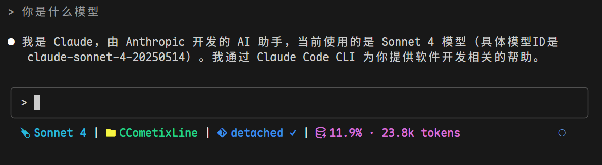

# CCometixLine

[English](README.md) | [中文](README.zh.md)

基于 Rust 的高性能 Claude Code 状态栏工具，集成 Git 信息、使用量跟踪、交互式 TUI 配置和 Claude Code 补丁工具。


## 截图



状态栏显示：模型 | 目录 | Git 分支状态 | 上下文窗口信息

## 特性

### 核心功能

- **高级Git集成** 分支、状态、跟踪、SHA显示和远程状态
- **智能模型显示** 自定义名称映射和多种显示格式
- **增强使用量跟踪** 进度条、警告阈值和灵活的令牌单位
- **灵活目录显示** 路径截断、大小写样式和父目录选项
- **全面会话跟踪** 多种时间格式和空闲时间监控
- **详细成本跟踪** 多种货币格式和精度控制
- **简洁设计** 使用 Nerd Font 图标和可自定义分隔符

### 交互式 TUI 功能

- **交互式主菜单** 无输入时直接执行显示菜单
- **高级TUI配置界面** 实时预览和智能控件
- **丰富主题系统** 多种内置预设和自定义主题支持
- **精细段落自定义** 每个段落都有扩展配置选项
- **智能配置管理** 验证、默认值和重置功能

### 扩展配置选项

- **使用量段**: 进度条控制、警告阈值、令牌单位选择、进度条百分比/令牌显示
- **模型段**: 显示格式（名称/完整/自定义）、版本信息、缩写、自定义名称映射
- **会话段**: 时间格式（自动/短/长/数字）、毫秒显示、紧凑模式、空闲时间跟踪
- **成本段**: 货币格式（自动/固定/紧凑/科学计数法）、精度控制、成本分解、警告阈值
- **Git段**: SHA显示控制、远程状态、存储计数、标签显示、状态格式、分支长度限制
- **目录段**: 路径长度限制、大小写样式、完整路径切换、父目录显示、主目录缩写

### Claude Code 增强

- **禁用上下文警告** 移除烦人的"Context low"消息
- **启用详细模式** 增强输出详细信息
- **稳定补丁器** 适应 Claude Code 版本更新
- **自动备份** 安全修改，支持轻松恢复

## 安装

### 快速安装（推荐）

通过 npm 安装（适用于所有平台）：

```bash
# 全局安装
npm install -g @cometix/ccline

# 或使用 yarn
yarn global add @cometix/ccline

# 或使用 pnpm
pnpm add -g @cometix/ccline
```

使用镜像源加速下载：

```bash
npm install -g @cometix/ccline --registry https://registry.npmmirror.com
```

安装后：

- ✅ 全局命令 `ccline` 可在任何地方使用
- ⚙️ 按照下方提示进行配置以集成到 Claude Code
- 🎨 运行 `ccline -c` 打开配置面板进行主题选择

### Claude Code 配置

添加到 Claude Code `settings.json`：

**Linux/macOS:**

```json
{
  "statusLine": {
    "type": "command", 
    "command": "~/.claude/ccline/ccline",
    "padding": 0
  }
}
```

**Windows:**

```json
{
  "statusLine": {
    "type": "command", 
    "command": "%USERPROFILE%\\.claude\\ccline\\ccline.exe",
    "padding": 0
  }
}
```

**后备方案 (npm 安装):**

```json
{
  "statusLine": {
    "type": "command", 
    "command": "ccline",
    "padding": 0
  }
}
```

*如果 npm 全局安装已在 PATH 中可用，则使用此配置*

### 更新

```bash
npm update -g @cometix/ccline
```

<details>
<summary>手动安装（点击展开）</summary>

或者从 [Releases](https://github.com/Haleclipse/CCometixLine/releases) 手动下载：

#### Linux

#### 选项 1: 动态链接版本（推荐）

```bash
mkdir -p ~/.claude/ccline
wget https://github.com/Haleclipse/CCometixLine/releases/latest/download/ccline-linux-x64.tar.gz
tar -xzf ccline-linux-x64.tar.gz
cp ccline ~/.claude/ccline/
chmod +x ~/.claude/ccline/ccline
```

*系统要求: Ubuntu 22.04+, CentOS 9+, Debian 11+, RHEL 9+ (glibc 2.35+)*

#### 选项 2: 静态链接版本（通用兼容）

```bash
mkdir -p ~/.claude/ccline
wget https://github.com/Haleclipse/CCometixLine/releases/latest/download/ccline-linux-x64-static.tar.gz
tar -xzf ccline-linux-x64-static.tar.gz
cp ccline ~/.claude/ccline/
chmod +x ~/.claude/ccline/ccline
```

*适用于任何 Linux 发行版（静态链接，无依赖）*

#### macOS (Intel)

```bash
mkdir -p ~/.claude/ccline
wget https://github.com/Haleclipse/CCometixLine/releases/latest/download/ccline-macos-x64.tar.gz
tar -xzf ccline-macos-x64.tar.gz
cp ccline ~/.claude/ccline/
chmod +x ~/.claude/ccline/ccline
```

#### macOS (Apple Silicon)

```bash
mkdir -p ~/.claude/ccline  
wget https://github.com/Haleclipse/CCometixLine/releases/latest/download/ccline-macos-arm64.tar.gz
tar -xzf ccline-macos-arm64.tar.gz
cp ccline ~/.claude/ccline/
chmod +x ~/.claude/ccline/ccline
```

#### Windows

```powershell
# 创建目录并下载
New-Item -ItemType Directory -Force -Path "$env:USERPROFILE\.claude\ccline"
Invoke-WebRequest -Uri "https://github.com/Haleclipse/CCometixLine/releases/latest/download/ccline-windows-x64.zip" -OutFile "ccline-windows-x64.zip"
Expand-Archive -Path "ccline-windows-x64.zip" -DestinationPath "."
Move-Item "ccline.exe" "$env:USERPROFILE\.claude\ccline\"
```

</details>

### 从源码构建

```bash
git clone https://github.com/Haleclipse/CCometixLine.git
cd CCometixLine
cargo build --release
cp target/release/ccometixline ~/.claude/ccline/ccline
```

## 使用

### 配置管理

```bash
# 初始化配置文件
ccline --init

# 检查配置有效性  
ccline --check

# 打印当前配置
ccline --print

# 进入 TUI 配置模式
ccline --config
```

### 主题覆盖

```bash
# 临时使用指定主题（覆盖配置文件设置）
ccline --theme cometix
ccline --theme minimal
ccline --theme gruvbox
ccline --theme nord
ccline --theme powerline-dark

# 或使用 ~/.claude/ccline/themes/ 目录下的自定义主题
ccline --theme my-custom-theme
```

### Claude Code 增强

```bash
# 禁用上下文警告并启用详细模式
ccline --patch /path/to/claude-code/cli.js

# 常见安装路径示例
ccline --patch ~/.local/share/fnm/node-versions/v24.4.1/installation/lib/node_modules/@anthropic-ai/claude-code/cli.js
```

## 默认段落

显示：`目录 | Git 分支状态 | 模型 | 上下文窗口`

### Git 状态指示器

- 带 Nerd Font 图标的分支名
- 状态：`✓` 清洁，`●` 有更改，`⚠` 冲突
- 远程跟踪：`↑n` 领先，`↓n` 落后

### 模型显示

显示简化的 Claude 模型名称：

- `claude-3-5-sonnet` → `Sonnet 3.5`
- `claude-4-sonnet` → `Sonnet 4`
- `claude-fable-5-2` → `Fable 5.2`
- `claude-opus-5-5` → `Opus 5.5`（200K 上下文）
- `claude-opus-5-5[1m]` → `Opus 5.5 1M`（1M 上下文）

内置模型清单统一维护在项目根目录的 [`models.toml`](models.toml)，包含 Claude 各系列及 GLM、Kimi、Qwen 的名称、别名和上下文上限。文件在编译时嵌入可执行文件，安装后无需额外携带。常规新增模型只需修改此文件，再运行 `cargo test`、`cargo build --release` 并替换已安装的可执行文件，无需修改 Rust 代码。例如：

```toml
[[models]]
pattern = "claude-fable-5-2"
aliases = ["fable-5-2", "claude-5-2-fable"]
match_mode = "model_id"
display_name = "Fable 5.2"
context_limit = 200000
```

`aliases` 可省略。`match_mode = "model_id"` 匹配完整 ID，兼容日期和 `latest`、`preview` 等名称后缀，避免 `Fable 5` 误匹配 `Fable 5.2`。未指定模式时沿用大小写不敏感的子串匹配。规则按文件顺序首个命中项生效。

名称解析顺序为：**用户配置 → 内置模型清单 → Claude 通用解析 → Claude Code 提供的显示名称**。通用解析保留了对新版本、新系列、旧式 ID 和 `[1m]` 的支持。

需要自定义名称、适配特殊模型 ID 或调整上下文上限时，编辑 `~/.claude/ccline/models.toml`（Windows：`%USERPROFILE%\.claude\ccline\models.toml`）：

```toml
[[models]]
pattern = "claude-fable-5-2"
display_name = "Fable 5.2"
context_limit = 200000
```

如果文件中有 `models = []`，请用上述条目替换该行。用户配置与项目清单使用相同格式，也支持 `aliases` 和 `match_mode`；省略模式时保留原有子串匹配行为，更具体的规则应放在前面。用户配置可只写需要覆盖的条目，空文件、缺失或无法解析时仍使用内置清单。保存后，下次状态栏调用即生效，无需重新编译或安装。未配置的上下文上限默认采用 200K；`[1m]` 会为已识别名称添加 `1M`，并将上限设为 1M。名称自动识别不会推断模型的真实上下文容量。

### 上下文窗口显示

基于转录文件分析的令牌使用百分比，包含上下文限制跟踪。

## 配置

CCometixLine 支持通过 TOML 文件和交互式 TUI 进行全面配置：

- **配置文件**: `~/.claude/ccline/config.toml`
- **交互式 TUI**: `ccline --config` 实时编辑配置并预览效果
- **主题文件**: `~/.claude/ccline/themes/*.toml` 自定义主题文件
- **增强示例**: [`example_enhanced.toml`](example_enhanced.toml) 展示所有配置选项
- **自动初始化**: `ccline --init` 创建默认配置

### 可用段落

所有段落都支持广泛的自定义选项：

- **基础控制**: 启用/禁用切换、自定义分隔符和图标、颜色自定义
- **扩展选项**: 段落特定的高级配置，用于精细化控制

#### 支持扩展选项的段落：

- **目录段**: 路径显示控制、大小写样式、长度限制、父目录切换
- **Git段**: 分支信息、状态格式、SHA显示、远程跟踪、存储/标签信息
- **模型段**: 显示格式、自定义名称映射、版本信息、缩写控制
- **使用量段**: 可自定义元素的进度条、警告阈值、令牌单位选择
- **会话段**: 多种时间格式、毫秒精度、紧凑模式、空闲时间跟踪
- **成本段**: 货币格式化、精度控制、分解显示、警告阈值
- **输出样式段**: 输出格式显示（仅基础配置）

### 快速配置示例

#### 使用量段配置进度条

```toml
[[segments]]
id = "usage"
enabled = true

[segments.options]
display_format = "bar"           # 启用进度条模式
bar_show_percentage = true       # 显示百分比
bar_show_tokens = true          # 显示令牌数量
show_limit = true               # 显示总限制
warning_threshold = 75          # 75%时警告
critical_threshold = 90         # 90%时严重警告
```

#### Git段丰富信息配置

```toml
[[segments]]
id = "git" 
enabled = true

[segments.options]
show_sha = true                 # 显示提交SHA
sha_length = 7                  # SHA长度
show_remote = true              # 显示远程状态
show_stash = true              # 显示存储数量
status_format = "symbols"       # 使用符号显示状态
```

#### 模型段自定义名称配置

```toml
[[segments]]
id = "model"
enabled = true

[segments.options]
display_format = "custom"       # 使用自定义映射
abbreviate_names = true         # 使用缩写
# 自定义名称映射在 [segments.options.custom_names] 表中配置
```

完整配置示例请参考 [`example_enhanced.toml`](example_enhanced.toml)。

## 系统要求

- **Git**: 版本 1.5+ (推荐 Git 2.22+ 以获得更好的分支检测)
- **终端**: 必须支持 Nerd Font 图标正常显示
  - 安装 [Nerd Font](https://www.nerdfonts.com/) 字体
  - 中文用户推荐: [Maple Font](https://github.com/subframe7536/maple-font) (支持中文的 Nerd Font)
  - 在终端中配置使用该字体
- **Claude Code**: 用于状态栏集成

## 开发

```bash
# 构建开发版本
cargo build

# 运行测试
cargo test

# 构建优化版本
cargo build --release
```

## 路线图

- [X] TOML 配置文件支持
- [X] TUI 配置界面
- [X] 自定义主题
- [X] 交互式主菜单
- [X] Claude Code 增强工具
- [X] **扩展段落配置选项**
  - [X] 使用量段进度条控制
  - [X] 自定义模型名称映射
  - [X] 会话段多种时间格式
  - [X] 成本段货币格式化
  - [X] 增强Git状态显示选项
  - [X] 目录路径显示控制
- [X] **高级TUI界面改进**
  - [X] 基于选项类型的智能控件选择
  - [X] 实时配置验证
  - [X] 增强预览功能
  - [X] 快速重置功能

## 贡献

欢迎贡献！请随时提交 issue 或 pull request。

## 许可证

本项目采用 [MIT 许可证](LICENSE)。

## Star History

[](https://star-history.com/#Haleclipse/CCometixLine&Date)
